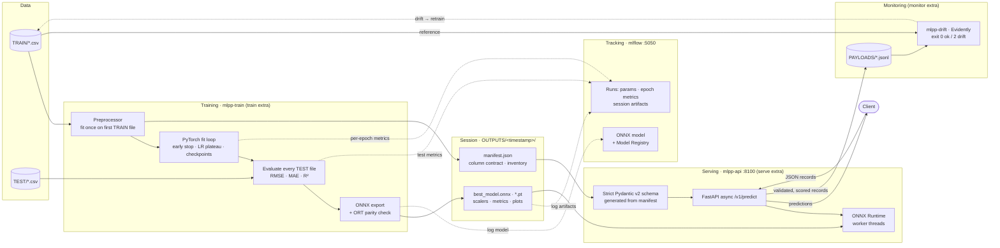

# ML Prediction Pipeline — Time-Series Regression (CNN + Bi-GRU)

An end-to-end MLOps pipeline for **time-series / tabular regression**: train in PyTorch, track
in MLflow, serve through ONNX Runtime behind an async FastAPI service, and watch live traffic
for data drift with Evidently.

- **Model**: Conv1D → stacked Bidirectional GRU → linear head, in PyTorch
- **Serving**: exported to ONNX and checked against PyTorch on real rows before it ships; the API,
  CLI and dashboard all run it on ONNX Runtime, so none of them needs torch
- **Tracking**: MLflow records params, per-epoch losses, test metrics, the session artifacts and the
  ONNX model (optionally registered in the Model Registry)
- **Contract**: a versioned `manifest.json` per session is the single source of truth for the
  feature columns. The API's strict Pydantic v2 request schema is generated from it
- **Monitoring**: every scored payload is captured; `mlpp-drift` compares it with the training data
  and exits non-zero on drift
- **Packaging**: a multi-stage, non-root serving image, plus a compose stack with the API and an MLflow
  server

---

## 🗺️ Architecture



**Two rules hold the system together.** The model is fitted and exported once per session, and
every consumer (API, `mlpp-predict`, dashboard, notebook) loads the same `best_model.onnx` through
the same `mlpp.predict.score_frame`, so they cannot disagree about preprocessing. And the column
contract lives in exactly one place, `manifest.json`: the API's request schema, `/v1/model`, the
drift column set and the dashboard forms are all derived from it.

---

## 📦 Repository structure

```
.
├─ apps/backend/                    # the `mlpp` uv project — all logic
│  ├─ src/mlpp/
│  │  ├─ config · data · preprocess · metrics · session · errors · importance   (framework-free)
│  │  ├─ schemas/inference.py       # strict Pydantic v2 request/response/error models
│  │  ├─ training/                  # PyTorch: model · loop · export (ONNX) · tracking (MLflow)
│  │  ├─ inference/                 # onnx_model · service · api (FastAPI) · settings
│  │  ├─ monitoring/                # payloads (capture) · drift (Evidently) · drift_cli
│  │  ├─ pipeline · cli · predict · predict_cli · plots
│  │  └─ dashboard/                 # Streamlit session explorer
│  ├─ tests/                        # one module per source module
│  ├─ pyproject.toml · uv.lock
├─ docker/
│  ├─ api.Dockerfile                # multi-stage serving image
│  └─ api.Dockerfile.dockerignore
├─ docker-compose.yml               # api + mlflow
├─ notebooks/                       # demo report over OUTPUTS/example (generated)
├─ TRAIN/ · TEST/                   # sample CSVs
├─ OUTPUTS/example/                 # committed reference session (schema v3)
├─ PAYLOADS/                        # captured inference payloads (git-ignored)
├─ mlruns/                          # local MLflow store when no server is used (git-ignored)
└─ scripts/                         # quickstart · notebook generator · drift gate
```

Dependencies are split so each runtime installs only what it runs:

| Install | Contents | Used by |
| --- | --- | --- |
| core | numpy, pandas, scikit-learn, **onnxruntime**, **pydantic** | `mlpp-predict`, session tooling |
| `--extra train` | torch, onnx, onnxscript, mlflow, matplotlib, plotly | `mlpp-train` |
| `--extra serve` | fastapi, uvicorn, pydantic-settings | `mlpp-serve`, the Docker image |
| `--extra monitor` | evidently | `mlpp-drift` |

---

## 🚀 Quickstart

Requires [uv](https://docs.astral.sh/uv/getting-started/installation/). **No pip, venv or conda.**

```bash
./scripts/quickstart.sh              # sync everything, then train (tracked to mlruns/)
./scripts/quickstart.sh --epochs 20  # flags pass through to mlpp-train
```

Step by step, from `apps/backend/`:

```bash
uv sync --all-extras --all-groups
uv run mlpp-train --epochs 5         # new session under OUTPUTS/<timestamp>/
uv run mlpp-train --help             # columns, loss, seed, device, tracking, plots…
```

### 1 · Train and track

`mlpp-train` records every run in MLflow. The tracking URI resolves in this order: `--tracking-uri`,
then `$MLFLOW_TRACKING_URI`, then a SQLite store under `mlruns/` in the repo. MLflow's own default
would drop an `mlflow.db` into whatever directory you happen to run from.

```bash
uv run mlpp-train                                         # local store under mlruns/
MLFLOW_TRACKING_URI=http://localhost:5050 uv run mlpp-train  # the compose server
uv run mlpp-train --experiment tuning --register-model mlpp-regressor
uv run mlpp-train --no-tracking
```

One run is opened per session and named after the session directory. It records:

| What | Keys |
| --- | --- |
| params | `train.*`, `eval.*`, `data.*` (column contract, files, `n_features`), `model.n_parameters` |
| per epoch (global step across stages) | `train_loss`, `train_mae`, `val_loss`, `val_mae`, `learning_rate`, `stage` |
| per evaluation | `eval.stage_NN.<test file>.{rmse,mae,mse,r2}`, plus `test_<metric>_mean` for the exported model |
| artifacts | the whole session under `session/`; the ONNX graph as an MLflow model with an inferred signature |

If a run raises, it is closed as `FAILED`. An unreachable server fails before training starts.

### 2 · Serve

```bash
uv run mlpp-serve --session ../../OUTPUTS/example        # http://127.0.0.1:8100/docs
```

```bash
curl -s localhost:8100/v1/predict -H 'Content-Type: application/json' -d '{
  "records": [{"feature_01": 0.1, "feature_02": -0.3, "feature_03": 1.2, "feature_04": 0.0,
               "feature_05": 0.5, "feature_06": -1, "feature_07": 0.2, "feature_08": 0.9,
               "feature_09": -0.4, "feature_10": 0.3, "feature_11": 0.1, "feature_12": -0.2,
               "comp_active": 1}]}'
# {"request_id":"…","model":{"session":"example",…},"n_records":1,"predictions":[0.965…],
#  "unseen_levels":{},"warnings":[]}
```

| Endpoint | Purpose |
| --- | --- |
| `GET /health/live` | the process is up; never touches the model |
| `GET /health/ready` | the model is loaded (503 until then); used by the Docker `HEALTHCHECK` |
| `GET /v1/model` | the column contract, feature order, batch limit and ONNX runtime metadata |
| `POST /v1/predict` | score 1..`MLPP_MAX_BATCH_ROWS` records; predictions are in the target's own units |

**The request schema is strict where the preprocessor is lenient.** Every input column is
required and non-null. Unknown keys are rejected, including the target. Numerics must be finite
JSON numbers: no `NaN`, no `Infinity`, no `"1.5"` strings, no booleans. Categoricals are strings or
integers. Every failure is a `422` carrying one `ErrorDetail` per problem, located by column name
(`["records", 3, "feature_07"]`), and the payload is never echoed back. Other responses keep the
same `ErrorResponse` shape: `413` for an oversized body, `415` for a non-JSON body, `503` while
loading, `500` with no internals. Every response carries an `X-Request-ID` header.

Scoring runs in worker threads, so health checks stay responsive under load. A semaphore caps
in-flight calls at `MLPP_MAX_CONCURRENCY`.

| Setting (env) | Default | |
| --- | --- | --- |
| `MLPP_SESSION_DIR` | — | session directory to serve (required) |
| `MLPP_MAX_BATCH_ROWS` | 1000 | records per request |
| `MLPP_MAX_BODY_BYTES` | 5 MiB | larger bodies get 413 before parsing |
| `MLPP_MAX_CONCURRENCY` | 4 | scoring calls in flight |
| `MLPP_INTRA_OP_THREADS` | runtime default | ONNX Runtime threads per call |
| `MLPP_PAYLOAD_DIR` | unset (off) | capture scored payloads for drift analysis |

### 3 · Monitor for drift

With `MLPP_PAYLOAD_DIR` set, every validated, scored record is appended to
`payloads-<UTC date>-<host>-<pid>.jsonl`, one file per worker, so replicas sharing a volume never
interleave lines. Capture is best-effort: a write failure is logged, and the prediction is still
returned.

```bash
uv run mlpp-drift --session ../../OUTPUTS/example --current ../../PAYLOADS \
  --html drift.html --json drift.json
# no dataset drift: 0/13 column(s) drifted (share 0.00, threshold 0.50; reference 3000 rows, current 800 rows)
#   comp_active  ok     Jensen-Shannon distance: 0.005598 (threshold 0.1)
#   feature_01   ok     Wasserstein distance (normed): 0.05099 (threshold 0.1)
#   …
```

The reference is every CSV in `TRAIN/` by default (`--reference` overrides it). The columns
compared come from the session's manifest. Evidently picks a test per column from its type and
sample size. A column drifts when its test fails, and the dataset drifts once `--drift-share` of
the columns have drifted. The exit status is the verdict: `0` no drift, `2` drift, `1` could not
run. That lets a cron job or CI step gate a retrain on it.

> **Sample size matters.** With a training-sized reference, Evidently uses normed Wasserstein
> distance with a 0.1 threshold for numerics. At a few hundred current rows, that threshold sits
> near the 95th percentile of the *no-drift* statistic, so an individual column false-positives
> about 10% of the time. Read single-column flags on small windows as hints, and gate on the
> dataset-level verdict or on larger windows.

### 4 · Run the stack in Docker

```bash
docker compose up -d --build
curl -s localhost:8100/health/ready
open http://localhost:5050          # MLflow UI
MLFLOW_TRACKING_URI=http://localhost:5050 uv run --project apps/backend mlpp-train
docker compose down                 # add -v to wipe MLflow's volumes
```

- **`api`** is built from `docker/api.Dockerfile`. A uv builder stage resolves only the locked `serve`
  extra into `/opt/venv`, and a clean `python:3.12-slim` runtime gets that venv and nothing else: no
  uv, no sources, no torch. The build fails if torch or mlflow would be importable. The container
  runs as uid 10001 with a read-only root filesystem, all capabilities dropped and CPU/memory
  limits. The served session is mounted read-only (`MLPP_SESSION=./OUTPUTS/<run>` picks another),
  and captured payloads land in `./PAYLOADS` on the host. On Linux, make that directory writable
  by uid 10001 (`mkdir -p PAYLOADS && sudo chown 10001 PAYLOADS`). Docker Desktop on macOS needs
  nothing.
- **`mlflow`** runs `ghcr.io/mlflow/mlflow:v3.17.2` on SQLite with `--serve-artifacts`, so clients
  upload through the server. Store and artifacts live in named volumes.

Both bind to `127.0.0.1` only. Ports 8100 and 5050 stay clear of the other local projects, and of
macOS AirPlay, which holds 5000. Variables are documented in `.env.template`.

### Scoring files and exploring sessions

```bash
uv run mlpp-predict --session ../../OUTPUTS/example \
  --input ../../TEST/sample_test_A.csv --output /tmp/preds.csv     # CSV or Parquet
uv run --group dashboard streamlit run src/mlpp/dashboard/app.py    # session explorer
```

Unseen categorical levels warn rather than fail, in every interface. They are encoded as
all-zeros, which still yields a number, so the affected columns and row count are reported.

The notebook `notebooks/01_exploration_and_baseline.ipynb` is a generated, executed report over
`OUTPUTS/example/`. Regenerate it with
`uv run --project apps/backend python scripts/build_notebook.py --execute`. Plain regeneration
strips the outputs, and the CI drift gate compares source only.

---

## 🧠 Task & data schema

Regression on time-ordered rows: predict a continuous `target`. The default inputs are
`feature_01 .. feature_12, comp_active`; override them with `--input-columns`. CSV delimiters are
sniffed, with `;` and `,` fallbacks. Under the default strict schema, a missing input column fails
fast.

`X` is shaped `(rows, n_features, 1)`. Conv1D and the GRUs run across the **feature axis**, not
across time.

---

## 📊 Session artifacts

Per session directory `OUTPUTS/<timestamp>/` (schema version 3):

| File | Role | Contents |
| --- | --- | --- |
| `manifest.json` | — | schema version, `session_id`, the column contract, an inventory of every file below |
| `best_model.onnx` | `best_model` | the graph every scorer runs; dynamic batch axis, opset 18 |
| `best_model.pt` | `best_checkpoint` | PyTorch state dict of the best weights (`weights_only` load) |
| `model_iter_NN.pt` | `stage_model` | checkpoint after each training stage |
| `scaler.gz`, `output_scaler.gz`, `encoders.gz` | fitted state | preprocessing estimators |
| `history_train_NN.csv`, `training_log.csv` | history | per-epoch metrics |
| `training_curves_train_NN.png`, `prediction_analysis_trNN_teNN.html` | plots | curves, truth vs prediction |
| `test_metrics.csv` | `metrics` | MSE/RMSE/MAE/R² per (train stage, test file) |

Sessions written under a different `schema_version` are **rejected, not migrated**. Regenerating
one takes seconds. Version 1 (Keras) and version 2 (pre-`session_id`) sessions do not load.

`session_id` is the directory name the session was created under. It is the identity the API reports
in every response (`model.session`) and the MLflow run name, so a session keeps its identity when
it is copied, renamed or mounted at `/models/session` in the container.

---

## 🔄 Reproducibility & correctness

- Seeded Python/NumPy/PyTorch RNGs and a seeded batch shuffler (`--seed`), verified reproducible by
  a test.
- The fit loop reproduces the Keras behaviour it replaced: early stopping with best-weight restore,
  LR decay on plateau, best-only checkpoints, an appending CSV log, Keras' trailing
  `validation_split`, sample weights and the GRU-kernel L2 penalty. The port has exactly the Keras
  parameter count (289,473 for 13 features), and the reference run's test R² is 0.906 / 0.902
  against Keras' 0.907 / 0.904.
- A non-finite loss raises `TrainingError` instead of silently training on NaNs.
- The ONNX export is re-scored through ONNX Runtime on real training rows and rejected if it
  differs from PyTorch by more than 1e-4.
- **Preprocessing is fitted once**, on the first training file, so evaluation cannot leak. Feature
  order is frozen at fit time and recorded in the manifest.

---

## 🧪 Development

From `apps/backend/`:

```bash
uv run pytest -m 'not slow'   # fast suite: no torch, no Evidently, no MLflow runs
uv run pytest                 # full suite: trains, exports, tracks, runs Evidently
uv run ruff check . && uv run ruff format --check .
uv run mypy src/mlpp          # strict
```

The API tests run the real app, validation, preprocessor and inverse transform, and mock only the
ONNX `InferenceSession`. A tiny real ONNX graph, built with `onnx.helper`, covers genuine ONNX
Runtime execution in the fast suite.

## 🤖 CI

`.github/workflows/ci.yml` runs on every push and PR to `main`:

- **quality** (Python 3.12, 3.13): `uv sync --locked --all-extras`, ruff, strict mypy, and the full
  pytest suite, which executes the notebook.
- **notebook-drift**: checks the committed notebook's cell source against its generator.
- **docker**: validates the compose file, builds the serving image, then starts it against
  `OUTPUTS/example` and checks readiness, one prediction and the non-root user.

## 🗺️ Roadmap

- [x] `mlpp-predict` CLI, GitHub Actions
- [x] MLflow experiment tracking and model registry
- [x] ONNX Runtime serving behind FastAPI, strict request schema
- [x] Payload capture and Evidently drift detection
- [ ] Scheduled drift job that opens a retraining run on exit code 2
- [ ] Serve straight from the MLflow Model Registry (`models:/mlpp-regressor@champion`)

---

## 📄 License

MIT — see [LICENSE](LICENSE).
